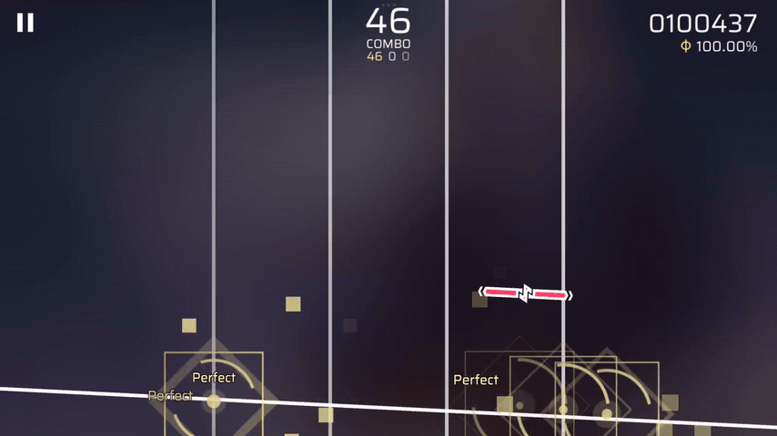
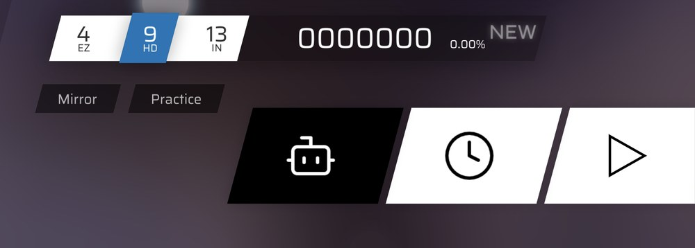
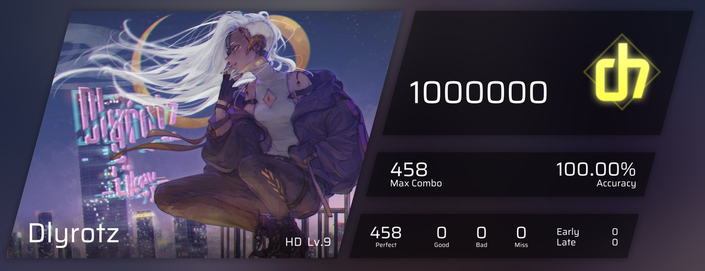

# Autoplay

A mod for [Phigros++](https://github.com/ggmolly/PhigrosPlusPlus) that plays a chart for you, every note a Perfect with the game's own hit sounds, effects and combo. A button left of the play button on the song list turns it on, and the songs started while it's on play themselves. Nothing of such a play counts: the result screen shows with its grade upside down, and no record, data, unlock, replay or phigros.tools sync comes out of it.

## Install

Open the **Mods** tab of the game's settings and pick Autoplay in the catalog, or open [this link](phigrospp://install/ggmolly/phigrospp-autoplay) on the device.

## Using it

The robot button left of the replays turns autoplay on, black while it's on. It turns off again whenever the game restarts.

## How it works

The game judges a tap when a finger lands on it, then scores it by how far it is from its time. The mod marks each note as touched in the frame closest to its time, right before the game judges its notes, and keeps a finger on holds until they end, so the game itself gives the Perfect. Touches on the screen judge nothing meanwhile, the pause button still works.

Phigros++ shows a replay's result screen without letting it save, the mod asks the same for its plays with `phigrospp.counts(false)`. It isn't used in challenge mode, and it's off again each time the game starts.

It needs a Phigros++ newer than 0.3.0-beta.1, for `phigrospp.counts`. On iOS it needs JIT, its hooks aren't written into the IPA.
